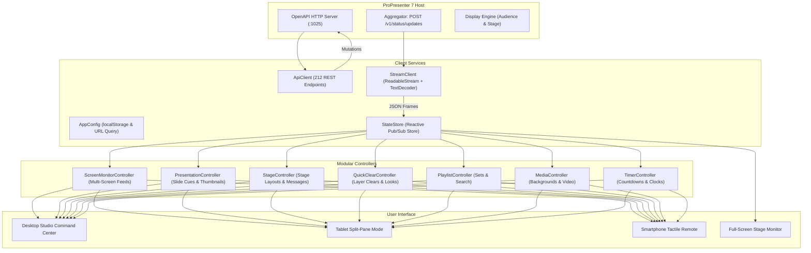

# ProPresenter Web Studio Controller: Technical Code Documentation

## 1. Architecture Overview

The **ProPresenter Web Studio Controller** is a high-performance, responsive web application engineered to control and monitor ProPresenter 7+ over its native OpenAPI HTTP server (`http://192.168.0.200:1025`).

### High-Level System Architecture


---

## 2. Directory & File Structure

```
Propresenter-Control/
├── index.html                   # Root entry point (auto-redirects to pages/index.html)
├── CODE_DOCUMENTATION.md        # This comprehensive technical documentation
├── README.md                    # Quick-start guide & operator instructions
├── pages/
│   ├── index.html               # Main Web Studio Controller interface
│   ├── stageMonitor.html        # High-contrast Stage Confidence Monitor
│   └── login.html               # Host connection & server discovery form
├── css/
│   ├── theme.css                # ProPresenter 7 Dark Slate design tokens & base reset
│   ├── layout.css               # Responsive multi-device flex/grid layout
│   ├── components.css           # Cues, tactile clear buttons, screen cards, modals
│   └── login.css                # Glassmorphism login styling
├── js/
│   ├── config.js                # AppConfig: LocalStorage & URL parameter management
│   ├── login.js                 # Login connection tester & validator
│   ├── app.js                   # Application bootstrap and controller coordinator
│   ├── api/
│   │   ├── api-client.js        # ApiClient: Full REST wrapper for all 22 API domains
│   │   └── stream-client.js     # StreamClient: Multiplexed chunk stream reader
│   ├── state/
│   │   └── store.js             # StateStore: Reactive centralized Pub/Sub store
│   └── controllers/
│       ├── screen-monitor.js    # ScreenMonitorController: Multi-screen live output feeds
│       ├── presentation-ctrl.js # PresentationController: Cues grid & thumbnail loader
│       ├── stage-ctrl.js        # StageController: Stage layouts & stage messages
│       ├── quick-clear-ctrl.js  # QuickClearController: Tactile layer clear bar & looks
│       ├── playlist-ctrl.js     # PlaylistController: Service sets, songs, live search
│       ├── media-ctrl.js        # MediaController: Background loops & media playlists
│       └── timer-ctrl.js        # TimerController: Video countdowns & production clocks
└── legacy/                      # Archived pre-overhaul monolithic files
    ├── script.legacy.js
    └── style.legacy.css
```

---

## 3. Core Services Reference

### 3.1 `AppConfig` (`js/config.js`)
Manages configuration resolution, persistence in `localStorage`, and URL query parameter parsing.

- **`AppConfig.DEFAULT_IP`**: `"192.168.0.200"`
- **`AppConfig.DEFAULT_PORT`**: `"1025"`
- **`AppConfig.getConfig()`**: Resolves effective IP/Port. URL parameters `?ip=...&port=...` override saved values.
- **`AppConfig.saveConfig(ip, port)`**: Stores verified parameters in `localStorage`.
- **`AppConfig.setConnected(version)`**: Stores connection flag and software version.

---

### 3.2 `ApiClient` (`js/api/api-client.js`)
Complete REST API client covering all 22 ProPresenter OpenAPI categories with automatic timeout handling.

#### Key Methods:
- **System**:
  - `getVersion()`: Returns software version and host OS description (`/version`).
- **Screens & Status**:
  - `getScreens()`: Returns all configured outputs (`/v1/status/screens`).
  - `getAudienceScreenStatus()` / `setAudienceScreenStatus(bool)`: Toggles Audience screens.
  - `getStageScreenStatus()` / `setStageScreenStatus(bool)`: Toggles Stage screens.
  - `getLayers()`: Returns active visual layers (`/v1/status/layers`).
  - `getSlideStatus()`: Returns current and next slide text (`/v1/status/slide`).
- **Presentations & Cues**:
  - `getActivePresentation()`: Returns active presentation structure.
  - `getSlideIndex()`: Returns active slide index.
  - `getSlideThumbnailUrl(uuid, index, quality)`: Constructs JPEG thumbnail URL.
  - `triggerSlide(uuid, index)`: Fires a specific slide cue.
  - `triggerNextSlide()` / `triggerPreviousSlide()`: Advances or steps back.
  - `timelineOperation(op)`: Play, pause, or rewind presentation timeline.
- **Stage Display & Messages**:
  - `getStageScreens()` / `getStageLayouts()` / `getStageLayoutMap()`: Stage screen topologies.
  - `setStageLayoutMap(map)`: Changes active layout per stage screen.
  - `getStageMessage()` / `setStageMessage(msg)` / `clearStageMessage()`: Live stage messages.
  - `getChordChartUrl(quality)`: Returns live chord chart image.
- **Clearing & Looks**:
  - `clearLayer(layer)`: Clears `'slide'`, `'media'`, `'props'`, `'messages'`, `'audio'`.
  - `clearAll()`: Clears all primary visual projection layers in parallel.
  - `getLooks()` / `getCurrentLook()` / `triggerLook(id)`: Audience look management.
- **Playlists, Media, Timers, Macros, Capture**:
  - `getPlaylists()`, `getLibraries()`, `getMediaPlaylists()`, `getTimers()`, `getMacros()`, `getCaptureStatus()`.

---

### 3.3 `StreamClient` (`js/api/stream-client.js`)
Solves the browser 6-connection concurrency limit by aggregating all real-time events into a single persistent HTTP connection via `POST /v1/status/updates`.

#### Chunk Parsing Protocol:
```javascript
// Chunks are delimited by double CRLF (\r\n\r\n or \n\n)
const messages = this.buffer.split(/\r?\n\r?\n/);
this.buffer = messages.pop(); // Keep incomplete trailing fragment

for (const rawMessage of messages) {
  const parsed = JSON.parse(rawMessage.trim());
  this.onEvent(parsed.url, parsed.data); // Dispatches { url, data }
}
```

#### Reconnect Engine:
- Automatic reconnect with exponential backoff (`1.5s`, `2.25s`, `3.37s`... up to `15s`).
- State transitions: `connecting` → `connected` → `reconnecting` → `disconnected`.

---

### 3.4 `StateStore` (`js/state/store.js`)
Centralized reactive state store using a Publish/Subscribe pattern.

#### Event Subscriptions:
| Event Name | Trigger Condition | Payload Data |
| :--- | :--- | :--- |
| `screens:updated` | Display topology received | `ScreenObject[]` |
| `screen:audience` | Audience output power toggled | `boolean` |
| `screen:stage` | Stage output power toggled | `boolean` |
| `slide:status` | Slide text or notes changed | `{ current: {...}, next: {...} }` |
| `presentation:slide_index` | Active cue position changed | `{ index: number, presentation_id: {...} }` |
| `presentation:active` | Active presentation changed | `PresentationObject` |
| `stage:message` | Stage message posted or cleared | `string` |
| `timer:video_countdown`| Video countdown timer ticks | `string` (e.g. "02:30") |
| `capture:status` | Livestream/recording state change | `{ status, capture_time }` |
| `look:current` | Audience look preset changed | `LookObject` |
| `layers:updated` | Projection layer toggled | `LayersObject` |

---

## 4. Modular Controllers Reference

### 4.1 `ScreenMonitorController` (`js/controllers/screen-monitor.js`)
Fulfills **Requirement 1** (Multi-screen live output monitor):
- Renders dedicated visual cards for every physical screen:
  - **Sony TV** (Audience Screen): Live slide thumbnail preview (`getSlideThumbnailUrl`), current text overlay, active layer chips (`Slide`, `Media`, `Props`), and power button.
  - **Stage Screen & ATEM** (Stage Screens): Live Current vs. Next slide text, active stage layout, stage message alert, and power button.
- Subscribes to `presentation:slide_index` and `slide:status` to update previews in real time without page reload.

### 4.2 `PresentationController` (`js/controllers/presentation-ctrl.js`)
- Flattens presentation groups (Verse, Chorus, Bridge, Tag) into an array of slide cues with group color indicators.
- Asynchronously loads thumbnails with loading spinners and error fallbacks.
- **Bi-Directional Slide Synchronization**:
  - **Web $\rightarrow$ ProPresenter**: Clicking a slide card calls `POST /v1/presentation/{uuid}/{index}/trigger` and immediately highlights the slide as LIVE.
  - **ProPresenter Software $\rightarrow$ Web**: Continuously monitors `GET /v1/presentation/slide_index` (polling every 1s and ingest from streaming engine).
  - Extracts `presentation_index.index` and `presentation_index.presentation_id` (UUID & Name).
  - If the software operator clicks a slide in a new document, automatically fetches the document and populates its slide deck.
  - Applies active styling (`.active` glowing amber border + `LIVE` badge) and smoothly scrolls the card into view via `scrollIntoView({ behavior: 'smooth', block: 'nearest' })`.
- Provides keyboard shortcuts: **Space / Right Arrow** (Next), **Left Arrow** (Previous).
- Controls presentation timeline (Play, Pause, Rewind).

### 4.3 `StageController` (`js/controllers/stage-ctrl.js`)
- Stage message composer: Input field + Send + Clear with visual alert banner.
- Modal viewer for live song chord charts (`getChordChartUrl(900)`).
- Preloads stage layouts and mapping tables.

### 4.4 `QuickClearController` (`js/controllers/quick-clear-ctrl.js`)
- Tactile quick-clear buttons with press animations: Clear All, Slide, Media, Props, Messages, Audio.
- Audience Looks preset chips with active look highlighting.
- Macros pad with color-coded trigger buttons.
- Livestream / recording status badge and elapsed timer.

### 4.5 `PlaylistController` (`js/controllers/playlist-ctrl.js`)
- 3-Tier Sidebar Navigator: Tier 1 (Libraries), Tier 2 (Playlists / Sets), Tier 3 (Song Item Deck with search filter).
- **Dynamic 5-Second Library Polling**: Continuously polls `GET /v1/libraries` every 5 seconds (`startLibraryPolling()`) to automatically discover newly created, deleted, or renamed libraries in ProPresenter without requiring a browser refresh.
- Seamlessly updates the library list and counter badge while preserving the currently selected library active state.
- Focus-then-trigger workflow: clicking a song calls `GET /v1/presentation/{uuid}/focus` without firing slides; clicking individual slides triggers `GET /v1/presentation/{uuid}/{index}/trigger`.


### 4.6 `MediaController` (`js/controllers/media-ctrl.js`)
- Media playlist selector.
- Visual thumbnail grid for background video loops and motion graphics.
- One-click trigger to send media to the background layer.

### 4.7 `TimerController` (`js/controllers/timer-ctrl.js`)
- Video countdown progress bar displaying remaining playback time.
- Digital system clock updating every second.
- Configured timers list with Start, Stop, Reset, and **+1m** increment buttons.

### 4.8 Workspace Layout, View Switcher & Screen Controls
- **Sidebar Dimensions**:
  - Left Sidebar: `320px` width for library folders, playlists, and long song titles.
  - Right Sidebar: `390px` width for live screen preview box and the 6 interactive feature tabs.
- **Library & Playlist Selection**:
  - No default auto-selection upon initial load. Operators manually click a Library or Playlist to view its contents in Tier 3.
- **Audience & Stage Screen Toggles**:
  - When clicking the Audience icon, calls `GET /v1/status/audience_screens`, inverts the boolean state, and dispatches `POST /v1/status/audience_screens` with the updated value.
  - When clicking the Stage icon, calls `GET /v1/status/stage_screens`, inverts the boolean state, and dispatches `POST /v1/status/stage_screens` with the updated value.
- **Header View Switcher ("Show" vs "Bible")**:
  - Segmented control in the master header allowing the operator to toggle between presentation and scripture modes.
  - **Show Mode**: Displays ONLY the Presentation Cues Deck (`#cuesSectionWrapper`) locked to screen-based fixed height `calc(100vh - 175px)` with internal slide cues scrolling; completely hides the Bible section.
  - **Bible Mode**: Displays ONLY the Bible Scripture Presenter (`#middleRow3Bible`) locked to screen-based fixed height `calc(100vh - 175px)` with internal verse scrolling; completely hides the Presentation section.

---

## 5. ProPresenter 7 Theme & Design Tokens

Defined in [theme.css](file:///e:/Church%20Projects/Propresenter-Control/css/theme.css):

```css
:root {
  --bg-canvas: #0f1013;            /* Deep studio black */
  --bg-surface: #181a20;           /* Panel background */
  --bg-surface-elevated: #22252e;  /* Elevated card */
  --border-subtle: #262933;        /* 1px hairline border */
  --border-strong: #383d4c;        /* Active border */

  --accent-orange: #ff9f0a;        /* ProPresenter signature amber/orange */
  --accent-orange-glow: rgba(255, 159, 10, 0.4);

  --accent-cyan: #38bdf8;          /* Audience displays & song titles */
  --accent-purple: #c084fc;        /* Stage displays & confidence monitor */
  --color-success: #10b981;        /* Connected / Capture active / Audio playing */
  --color-danger: #ef4444;         /* Clear all / Disconnected / Stop capture */

  --font-sans: 'Inter', -apple-system, sans-serif;
  --font-mono: 'JetBrains Mono', Consolas, monospace;
}
```

---

## 6. How to Run & Deploy

### Running Locally
To launch the controller locally, use any static HTTP server from the project directory:

```bash
# Using Node.js built-in runner
node -e "const http=require('http'),fs=require('fs'),path=require('path');http.createServer((q,s)=>{let p=decodeURI(q.url.split('?')[0]);if(p==='/'||p==='')p='/pages/index.html';let f=path.join('.',p);if(!fs.existsSync(f)||fs.statSync(f).isDirectory()){s.writeHead(404);s.end('Not Found');return;}s.writeHead(200,{'Content-Type':f.endsWith('.html')?'text/html; charset=utf-8':f.endsWith('.css')?'text/css':f.endsWith('.js')?'application/javascript':'application/octet-stream'});fs.createReadStream(f).pipe(s);}).listen(8080,()=>console.log('Server running on port 8080'));"
```

### Accessing Across Network Devices
- **Desktop Operator Command Center**: `http://<YOUR_COMPUTER_IP>:8080/pages/index.html`
- **Stage Confidence Monitor (Pulpit TV / Musician iPad)**: `http://<YOUR_COMPUTER_IP>:8080/pages/stageMonitor.html`
- **Mobile Handheld Remote**: Scan the QR code generated directly within the header of the controller.
